<div align="center">



<br>


**CLI em Python e painel web para homelab** com downloads simultâneos, fila persistente
em SQLite, retomada automática, renomeação inteligente e sessão do Telegram
criptografada em repouso.

[Começo rápido](#começo-rápido) · [Como funciona](#como-funciona) · [Uso](#uso) · [Configuração](#configuração) · [API](#api-http)

</div>

---

## Sumário

- [Começo rápido](#começo-rápido)
- [Funcionalidades](#funcionalidades)
- [Como funciona](#como-funciona)
  - [Arquitetura](#arquitetura)
  - [Fluxo de um download](#fluxo-de-um-download)
  - [Downloads simultâneos](#downloads-simultâneos)
  - [Ciclo de vida de jobs e itens](#ciclo-de-vida-de-jobs-e-itens)
  - [Autenticação e sessão criptografada](#autenticação-e-sessão-criptografada)
- [Requisitos](#requisitos)
- [Instalação](#instalação)
- [Configuração](#configuração)
- [Autenticação](#autenticação)
- [Uso](#uso)
  - [Modo interativo](#modo-interativo)
  - [Linha de comando](#linha-de-comando)
  - [Interface web](#interface-web-homelab-ui)
  - [Docker Compose](#docker-compose)
- [Fila persistente e retomada](#fila-persistente-e-retomada)
- [API HTTP](#api-http)
- [Desenvolvimento](#desenvolvimento)
- [Solução de problemas](#solução-de-problemas)
- [Contribuindo](#contribuindo)
- [Licença](#licença)

---

## Começo rápido

```bash
git clone https://github.com/johnpaulo0602/telegram-media-downloader.git
cd telegram-media-downloader
python3 -m venv venv && source venv/bin/activate
pip install -r requirements.txt
cp .env.example .env   # preencha API_ID, API_HASH e TBMD_SESSION_KEY

python src/tbmd.py          # CLI interativa
python src/tbmd.py --web    # painel web em http://localhost:8000
```

> Prefere container? Veja [Docker Compose](#docker-compose).

---

## Funcionalidades

| | |
|---|---|
| **Login pela própria sessão do Telegram** | QR Code ou telefone (com 2FA) direto no painel. A sessão é salva **criptografada** na tabela `telegram_session` do SQLite (AES-256-GCM). |
| **Downloads simultâneos** | Paralelismo controlado por `asyncio.Semaphore`, aproveitando a banda sem estourar o limite da API. |
| **Fila persistente em SQLite** | Jobs, ordem da fila, pausa e histórico ficam no SQLite, junto dos status, tentativas e destinos de cada mídia. |
| **Retomada automática** | Arquivos já baixados são reconhecidos pelo histórico de mídias no SQLite e pela presença no destino. |
| **Resolução flexível de chat** | Aceita `@usuario`, `https://t.me/usuario`, IDs numéricos e IDs completos de canal (`-100...`). |
| **Busca sem acento** | `musica` encontra "Música"; também casa por username, link ou ID. |
| **Renomeação inteligente** | Usa a legenda, o nome original ou a extensão do MIME; sanitiza, trunca e prefixa o ID da mensagem para evitar colisões. |
| **Filtro por tipo** | Imagens, vídeos, PDFs, ZIP/compactados, áudios ou tudo. |
| **`FloodWaitError` tratado** | Espera exatamente a penalidade do Telegram e retoma sozinho. |
| **Painel web para homelab** | Fila FIFO de jobs, seleção de canais, explorador de pastas do host/Docker, telemetria de velocidade e disco, progresso ao vivo via WebSocket. |
| **CLI completa** | Menus interativos ou execução 100% não interativa por flags. |

---

## Como funciona

### Arquitetura

O projeto separa o **núcleo** (motor de download, fila e utilitários) das
**interfaces** (CLI e web): ambas reaproveitam exatamente o mesmo código.

<p align="center">
  
</p>

| Módulo | Responsabilidade |
|---|---|
| `src/tbmd.py` | Entry point único (`python src/tbmd.py`); delega para `src.cli.main.run_cli()` |
| `src/settings.py` | Carrega e valida o `.env` em um `Settings` tipado |
| `src/models.py` | Enums de status, dataclasses (`QueueItem`, `QueueStats`) e DTOs Pydantic |
| `src/utils.py` | Funções puras: sanitização de nomes, filtros de MIME, parsing de chat, navegador de arquivos |
| `src/queue_db.py` | Repositório SQLite da fila e do histórico (WAL, retentativas, migração do JSON legado) |
| `src/session_store.py` | Sessão do Telegram criptografada em repouso (AES-256-GCM, chave via scrypt) |
| `src/downloader.py` | Motor Telethon: sessões, workers concorrentes, eventos de progresso |
| `src/cli/main.py` | Parser de argumentos e loop principal da CLI |
| `src/cli/ui.py` | Tabelas Rich e menus interativos Questionary |
| `src/web/app.py` | Aplicação FastAPI, lifespan, token de acesso e WebSocket |
| `src/web/manager.py` | `WebDownloadManager`: orquestra jobs FIFO e o processador da fila |
| `src/web/auth.py` | Login por QR Code / telefone + 2FA |
| `src/web/routes/` | Roteadores separados: `auth.py`, `downloads.py`, `queue.py`, `filesystem.py` |

### Fluxo de um download

Do pedido do usuário ao resumo final — a CLI e o painel web seguem o mesmo caminho:

<p align="center">
  
</p>

### Downloads simultâneos

Os itens pendentes passam por um `asyncio.Semaphore(BATCH_SIZE)`: no máximo
`BATCH_SIZE` workers baixam ao mesmo tempo. Um worker que recebe `FloodWaitError`
aguarda a penalidade e retoma; arquivos que já existem são marcados como `skipped`
sem tráfego de rede.

<p align="center">
  
</p>

### Ciclo de vida de jobs e itens

Há dois níveis de estado: o **job** do painel (um pedido de download, na fila FIFO)
e cada **item de mídia**. Ambos são persistidos no mesmo SQLite, junto do contador de jobs e do estado de pausa da fila.

<p align="center">
  
</p>

### Autenticação e sessão criptografada

<p align="center">
  
</p>

> Todos os diagramas são SVGs estáticos em [`assets/`](assets/), com animações em CSS/SMIL
> que respeitam `prefers-reduced-motion`.

---

## Requisitos

- Python 3.8 a 3.14+
- Credenciais da API do Telegram (`API_ID` e `API_HASH`)
- Opcional: Docker + Docker Compose, para a interface web no homelab

---

## Instalação

### 1. Clone o repositório

```bash
git clone https://github.com/johnpaulo0602/telegram-media-downloader.git
cd telegram-media-downloader
```

### 2. Crie e ative um ambiente virtual

```bash
# macOS / Linux
python3 -m venv venv
source venv/bin/activate

# Windows (PowerShell)
python -m venv venv
venv\Scripts\activate
```

### 3. Instale as dependências

```bash
pip install --upgrade pip
pip install -r requirements.txt
```

### 4. Configure as variáveis de ambiente

```bash
cp .env.example .env
```

Preencha `API_ID`, `API_HASH` e `TBMD_SESSION_KEY` no `.env`:

> **Como obter as credenciais:** acesse [my.telegram.org](https://my.telegram.org) com o número da sua conta, abra **API development tools**, preencha o formulário e copie o `api_id` e o `api_hash`.

### 5. Entre na sua conta

Inicie o painel com `python src/tbmd.py --web` ou siga a instalação por [Docker Compose](#docker-compose). A própria tela de autenticação oferece QR Code ou telefone com código e senha de duas etapas, quando exigida pelo Telegram.

A CLI também permite autenticar com `python src/tbmd.py --list`. As duas interfaces salvam a sessão criptografada no banco definido por `DB_PATH`. Ao iniciar novamente com o mesmo banco e a mesma `TBMD_SESSION_KEY`, a aplicação restaura a autenticação.

---

## Configuração

| Variável | Padrão | Descrição |
|---|---|---|
| `API_ID` | *Obrigatório* | ID numérico da API do Telegram (my.telegram.org) |
| `API_HASH` | *Obrigatório* | Hash da API do Telegram |
| `DOWNLOAD_DIR` | `downloads` | Pasta base: no painel, cria `<pasta escolhida>/<canal_em_snake_case>`; na CLI, o padrão é `<DOWNLOAD_DIR>/<tipo>` |
| `BATCH_SIZE` | `5` | Máximo de downloads simultâneos (recomendado: 3 a 10) |
| `MESSAGE_LIMIT` | `2000` | Máximo de mensagens inspecionadas (`0` = ilimitado) |
| `DB_PATH` | `tbmd.db` | Banco SQLite de sessão criptografada, jobs, estado da fila e histórico de mídias; no Compose, `/app/data/tbmd.db` |
| `TBMD_SESSION_KEY` | *Obrigatório* | Chave de criptografia da sessão no banco; gere um valor aleatório forte e mantenha-o seguro |
| `TBMD_WEB_TOKEN` | *vazio* | Token de acesso ao painel; vazio = painel acessível sem token |
| `WEB_HOST` | `127.0.0.1` | Host do servidor web |
| `WEB_PORT` | `8000` | Porta do servidor web |

Pastas de destino por tipo de mídia (CLI): `images`, `videos`, `pdfs`, `archives`, `audio` e `all_media`.

> Gere uma `TBMD_SESSION_KEY` forte com:
>
> ```bash
> python -c "import secrets; print(secrets.token_urlsafe(32))"
> ```

---

## Autenticação

> Visão geral no diagrama [Autenticação e sessão criptografada](#autenticação-e-sessão-criptografada).

A sessão do Telegram **é** a autenticação: se ela existir no banco, você já entra; se não, o painel mostra a tela de login.

### Fluxo no painel web

1. **QR Code** (recomendado) — abra o Telegram no celular em **Ajustes → Aparelhos → Conectar dispositivo** e escaneie o código exibido no painel. O painel aguarda a confirmação no celular e solicita a senha de duas etapas se a conta tiver 2FA.
2. **Telefone** — informe o número com código do país, receba o código no Telegram e, se sua conta tiver verificação em duas etapas, digite a senha de 2FA.

### Como a sessão é guardada

Durante o login, o cliente mantém a sessão em memória. Antes de salvá-la na tabela `telegram_session`, a aplicação a criptografa com **AES-256-GCM**, usando uma chave derivada via **scrypt** de `TBMD_SESSION_KEY`.

- `TBMD_SESSION_KEY` é **obrigatória**: a aplicação recusa iniciar sem ela. Gere um valor forte com `python -c "import secrets; print(secrets.token_urlsafe(32))"` e guarde-o no `.env`.
- A chave **nunca é solicitada no painel web** nem enviada por API; ela é lida somente no servidor a partir do ambiente. Quem tiver acesso ao `.env` poderá descriptografar a sessão, portanto proteja esse arquivo.
- A chave incorreta é detectada pelo próprio GCM (falha de autenticação). Corrija `TBMD_SESSION_KEY` e reinicie o servidor; não faça login com uma chave diferente sobre a sessão existente.
- A sessão é revogada no Telegram e apagada do banco pelo botão **Sair** no cabeçalho.

### Protegendo o painel

Como a sessão do Telegram dá acesso total à conta, **defina `TBMD_WEB_TOKEN`** ao expor o painel na rede:

```env
TBMD_WEB_TOKEN=um-token-longo-e-aleatorio
```

Sem o token, a API responde `401` e o painel pede o acesso. Depois de autenticado, o navegador recebe um cookie `httpOnly`. Acesse também por `http://servidor:8000/?token=um-token-longo-e-aleatorio` para entrar direto.

O `WEB_HOST` padrão é `127.0.0.1` — ao publicar na rede, troque para `0.0.0.0` **e** defina o token.

---

## Uso

### Modo interativo

```bash
python src/tbmd.py
```

Navegue com as setas ↑/↓ e Enter:

1. **Escolha do chat** — listar canais e grupos, buscar pelo nome, ou informar username, link ou ID.
2. **Tipo de mídia** — imagens, vídeos, PDFs, compactados, áudios ou todos.
3. **Pasta de destino** — padrão `<DOWNLOAD_DIR>/<tipo>`; o Tab completa nomes de pasta.
4. **Resumo e confirmação** — painel com chat, tipo, pasta e quantidade encontrada.
5. **Progresso** — uma barra por arquivo (tamanho, velocidade, tempo restante) e uma barra geral.

### Linha de comando

```bash
# Lista seus canais e grupos
python src/tbmd.py --list

# Busca chats pelo nome
python src/tbmd.py --search "inglês"

# Baixa todos os vídeos de um canal, sem confirmações
python src/tbmd.py -c @canalexemplo -t videos -o ~/Videos/curso -y

# Estatísticas da fila SQLite
python src/tbmd.py --queue-stats

# Re-enfileira itens que falharam
python src/tbmd.py --retry-failed
```

| Opção | Descrição |
|---|---|
| `-c`, `--chat` | Username, link ou ID do chat |
| `-t`, `--type` | `images`, `videos`, `pdfs`, `archives`, `audios` ou `all` |
| `-o`, `--output` | Pasta de destino |
| `-l`, `--limit` | Máximo de mensagens analisadas (`0` = ilimitado) |
| `-b`, `--batch-size` | Downloads simultâneos |
| `-y`, `--yes` | Usa a pasta padrão e não pede confirmação |
| `--list` | Lista canais e grupos e sai |
| `--search TERMO` | Busca chats pelo nome e sai |
| `--queue-stats` | Mostra as estatísticas da fila SQLite e sai |
| `--retry-failed` | Re-enfileira itens com falha e sai |
| `--db CAMINHO` | Banco SQLite alternativo |
| `--web` | Inicia a interface web |
| `--host` | Host do servidor web |
| `--port` | Porta do servidor web |

### Interface web (Homelab UI)

```bash
python src/tbmd.py --web
python src/tbmd.py --web --port 8080
```

Acesse `http://localhost:8000` (ou o IP do servidor no homelab). A interface oferece seleção de canais, fila FIFO de jobs, explorador de pastas do host e dos volumes montados, telemetria de velocidade e disco em tempo real e logs por job.

### Docker Compose

1. Configure `.env`, incluindo `TBMD_SESSION_KEY` e, para proteger o painel, `TBMD_WEB_TOKEN`. Após iniciar o container, faça login diretamente no painel por QR ou telefone.
2. Copie o exemplo versionado e ajuste os volumes e portas na sua configuração local:

   ```bash
   cp docker-compose.example.yml docker-compose.yml
   ```

   `docker-compose.example.yml` é o modelo do repositório. `docker-compose.yml` fica no `.gitignore`, permitindo configurações próprias em cada instalação. Ao atualizar o projeto, compare o exemplo com seu arquivo local antes de incorporar mudanças.

3. Suba o container:

   ```bash
   docker compose up -d --build
   ```

O volume nomeado `tbmd-data` preserva `/app/data/tbmd.db` e seus arquivos WAL entre recriações. Não execute `docker compose down -v` se quiser preservar sessão e fila. A CLI local usa outro banco por padrão; para compartilhar o banco do container, execute `docker compose exec tbmd-web python src/tbmd.py --list`. Mantenha o mesmo `TBMD_SESSION_KEY` entre reinícios.

O SQLite em `DB_PATH` é a única persistência dos jobs e do estado da fila: `web_jobs` guarda os lotes, sua ordem e histórico; `web_queue_state` guarda o contador de IDs e o estado de pausa. Essas tabelas compartilham o banco com `queue_items` (mídias) e `telegram_session` (sessão criptografada). Tudo fica no volume `tbmd-data`, inclusive após recriar o container. Jobs e metadados são gravados na mesma transação, sem o antigo limite de 100 jobs que poderia descartar itens pendentes.

Para atualizar versões anteriores que ainda gravavam o histórico web em JSON, consulte [Atualização de instalações antigas](docs/UPGRADING.md) antes de recriar o container.

Jobs que estavam aguardando permanecem na fila e voltam a executar quando houver sessão autenticada e a fila não estiver pausada. Jobs interrompidos durante a execução ficam como cancelados após reiniciar e podem ser reenfileirados pelo painel.

No passo 3, o único atalho recomendado é `DOWNLOAD_DIR` (`/downloads` no container), apontando para o volume persistente. Você pode navegar e escolher outra pasta base.

O painel sempre cria uma subpasta com o nome real do canal em `snake_case`: por exemplo, “Curso de Python — Avançado” em `/downloads` resulta em `/downloads/curso_de_python_avancado`. Acentos, espaços, emojis e caracteres de caminho são normalizados; nomes sem letras ou números usam `canal_<id>`. Todos os tipos selecionados ficam juntos nessa pasta, sem subpastas por categoria. A prévia e o download usam o mesmo destino. Jobs já existentes mantêm os caminhos que tinham ao serem criados.

---

## Fila persistente e retomada

> Os estados abaixo aparecem no diagrama [Ciclo de vida de jobs e itens](#ciclo-de-vida-de-jobs-e-itens).

Todo item baixado é registrado no SQLite (`tbmd.db`, modo WAL) com status, número de tentativas e caminho de destino:

| Status | Significado |
|---|---|
| `pending` | Na fila, aguardando worker |
| `downloading` | Em download no momento |
| `completed` | Concluído com sucesso |
| `skipped` | Já existia no disco ou no histórico |
| `failed` | Falhou após as tentativas configuradas |
| `cancelled` | Cancelado pelo usuário ou por reinício |

- Ao executar novamente, as mídias já concluídas são reconhecidas e puladas. No painel, use **Retry** para reenfileirar um job interrompido.
- Itens com falha podem ser re-enfileirados em lote com `--retry-failed` ou pelo botão **Retry** no painel web.
- No painel, jobs, ordem, pausa e contador são restaurados do SQLite. Limpar o histórico não reinicia o contador nem faz reaparecer jobs apagados.

---

## API HTTP

| Método | Rota | Descrição |
|---|---|---|
| `GET` | `/` | Painel web (single page) |
| `GET` | `/ws` | WebSocket com o estado ao vivo |
| `GET` | `/api/status` | Snapshot do estado, ambiente e job ativo |
| `POST` | `/api/reconnect` | Reconecta ao Telegram |
| `GET` | `/api/auth/state` | Estado da autenticação (usado pelo painel) |
| `POST` | `/api/auth/qr` | Inicia o login por QR Code |
| `GET` | `/api/auth/qr/status` | Progresso do login por QR Code |
| `POST` | `/api/auth/phone` | Envia o código de login por telefone |
| `POST` | `/api/auth/code` | Confirma o código recebido |
| `POST` | `/api/auth/password` | Confirma a senha de 2FA |
| `POST` | `/api/auth/logout` | Revoga a sessão no Telegram e apaga do banco |
| `POST` | `/api/auth/token` | Valida o token de acesso do painel |
| `GET` | `/api/dialogs` | Lista e busca chats |
| `GET` | `/api/fs` | Navega o sistema de arquivos do host/Docker |
| `POST` | `/api/fs/mkdir` | Cria uma pasta |
| `POST` | `/api/downloads/preview` | Pré-visualiza as mídias do chat |
| `POST` | `/api/downloads/start` | Enfileira um job de download |
| `POST` | `/api/downloads/cancel` | Cancela o job em andamento |
| `POST` | `/api/jobs/{id}/cancel` | Cancela um job específico da fila |
| `POST` | `/api/jobs/{id}/retry` | Re-enfileira um job específico |
| `POST` | `/api/jobs/{id}/delete` | Remove um job do histórico |
| `POST` | `/api/jobs/{id}/move-up` | Reordena a fila |
| `POST` | `/api/jobs/clear-completed` | Limpa jobs concluídos e cancelados |
| `GET` | `/api/queue/stats` | Estatísticas da fila SQLite |
| `GET` | `/api/queue/items` | Itens da fila, com filtros e paginação |
| `POST` | `/api/queue/retry-failed` | Re-enfileira itens com falha |
| `POST` | `/api/queue/pause` | Pausa ou retoma o processador da fila |

---

## Desenvolvimento

```bash
python3 -m unittest discover tests
```

A suíte cobre os modelos de domínio, o banco da fila, o carregamento de
configurações, a CLI e os endpoints web. Rodar em um ambiente virtual já
provisionado:

```bash
.venv/bin/python -m unittest discover tests
```

---

## Solução de problemas

- **`Erro de configuração: API_ID não definido no .env`** — copie `.env.example` para `.env` e preencha `API_ID` e `API_HASH`.
- **`Não foi possível encontrar o chat`** — se o canal for privado, confirme que sua conta já entrou nele. Use `--search` para localizar o chat sem saber o ID.
- **`Limite de requisições do Telegram. Aguardando...`** — o Telegram limita requisições de mídia em rajadas. O downloader espera e retoma sozinho; reduza `BATCH_SIZE` para `2` ou `3` para aliviar.
- **A porta `8000` já está em uso** — use `python src/tbmd.py --web --port 8080` ou defina `WEB_PORT` no `.env`.

---

## Contribuindo

1. Crie uma branch para a sua mudança.
2. Mantenha o núcleo (`src/downloader.py`, `src/queue_db.py`, `src/utils.py`) independente das interfaces — a CLI e a web devem consumir os mesmos módulos.
3. Adicione ou atualize testes em `tests/` ao alterar sanitização de nomes, resolução de chat, estado ou fila.
4. Rode a suíte antes de abrir o PR.

---

## Licença

Distribuído sob a licença [GNU General Public License v3.0](LICENSE).

Projeto derivado de [mdic/telegram-batch-media-downloader](https://github.com/mdic/telegram-batch-media-downloader), também sob GPL-3.0.
