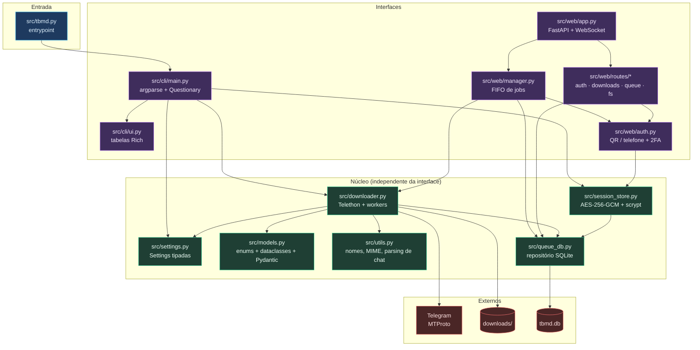
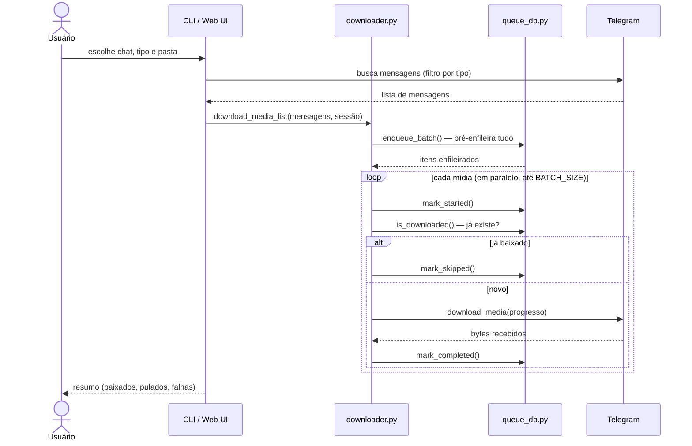

<div align="center">

# Telegram Media Downloader


**Baixe mídias em lote de canais, grupos e chats privados do Telegram.**

CLI em Python com downloads simultâneos, fila persistente em SQLite, retomada de
downloads interrompidos, renomeação automática de arquivos e um painel web para
homelab com progresso em tempo real.

[Instalação](#instalação) · [Uso](#uso) · [Arquitetura](#arquitetura) · [Configuração](#configuração)

</div>

---

## Sumário

- [Funcionalidades](#funcionalidades)
- [Arquitetura](#arquitetura)
- [Fluxo de um download](#fluxo-de-um-download)
- [Requisitos](#requisitos)
- [Instalação](#instalação)
- [Configuração](#configuração)
- [Uso](#uso)
  - [Modo interativo](#modo-interativo)
  - [Linha de comando](#linha-de-comando)
  - [Interface web](#interface-web-homelab-ui)
  - [Docker Compose](#docker-compose)
- [Fila persistente e retomada](#fila-persistente-e-retomada)
- [API HTTP](#api-http)
- [Desenvolvimento](#desenvolvimento)
- [Solução de problemas](#solução-de-problemas)
- [Contribuindo](#contribuindo)
- [Licença](#licença)

---

## Funcionalidades

- **Autenticação pela própria sessão do Telegram** — faça login no painel web por QR Code ou telefone; a sessão fica guardada **criptografada** no SQLite (AES-256-GCM), sem arquivo `.session` solto em disco.
- **Downloads simultâneos** — paralelismo controlado por `asyncio.Semaphore`, aproveitando a banda sem estourar o limite da API do Telegram.
- **Fila persistente em SQLite** — cada mídia é registrada em `tbmd.db` (modo WAL) com status, tentativas e caminho de destino; a fila sobrevive a reinícios do servidor.
- **Retomada automática** — downloads concluídos são reconhecidos e ignorados, tanto pelo `download_state.json` quanto pelo banco SQLite.
- **Resolução flexível de chat** — aceita `@usuario`, `https://t.me/usuario`, IDs numéricos e IDs completos de canal (`-100...`).
- **Busca de chats sem acento** — a busca ignora maiúsculas e acentos (`musica` encontra "Música") e também casa por username, link ou ID.
- **Renomeação inteligente** — usa a legenda da mensagem, ou o nome original do documento, ou a extensão do MIME; remove caracteres inválidos, trunca títulos longos e prefixa o ID da mensagem para evitar colisões.
- **Filtragem por tipo de mídia** — imagens, vídeos, PDFs, ZIP e compactados, áudios e todos os tipos.
- **Tratamento de `FloodWaitError`** — espera exatamente o tempo de penalidade do Telegram e retoma o download automaticamente.
- **Painel web para homelab** — fila FIFO de jobs, seleção de canais, explorador de pastas do host/Docker, telemetria de velocidade e disco, e progresso ao vivo via WebSocket.
- **Interface de linha de comando** — modo interativo com menus ou execução 100% não interativa por flags.

---

## Arquitetura

O projeto separa o **núcleo** (motor de download, fila e utilitários) das
**interfaces** (CLI e web), de modo que ambas reaproveitam exatamente o mesmo
código:



### Módulos

| Módulo | Responsabilidade |
|---|---|
| `src/tbmd.py` | Entry point único (`python src/tbmd.py`); delega para `src.cli.main.run_cli()` |
| `src/settings.py` | Carrega e valida o `.env` em um `Settings` tipado |
| `src/models.py` | Enums de status, dataclasses (`QueueItem`, `QueueStats`) e DTOs Pydantic |
| `src/utils.py` | Funções puras: sanitização de nomes, filtros de MIME, parsing de chat, navegador de arquivos |
| `src/queue_db.py` | Repositório SQLite da fila e do histórico (WAL, retentativas, migração do JSON legado) |
| `src/session_store.py` | Sessão do Telegram criptografada em repouso (AES-256-GCM, chave via scrypt) |
| `src/downloader.py` | Motor Telethon: sessões, workers concorrentes, eventos de progresso |
| `src/cli/main.py` | Parser de argumentos e loop principal da CLI |
| `src/cli/ui.py` | Tabelas Rich e menus interativos Questionary |
| `src/web/app.py` | Aplicação FastAPI, lifespan e WebSocket |
| `src/web/manager.py` | `WebDownloadManager`: orquestra jobs FIFO e o processador da fila |
| `src/web/routes/` | Roteadores separados: `downloads.py`, `queue.py`, `filesystem.py` |

---

## Fluxo de um download



---

## Requisitos

- Python 3.8 a 3.14+
- Credenciais da API do Telegram (`API_ID` e `API_HASH`)
- Opcional: Docker + Docker Compose, para a interface web no homelab

---

## Instalação

### 1. Clone o repositório

```bash
git clone https://github.com/johnpaulo0602/telegram-media-downloader.git
cd telegram-media-downloader
```

### 2. Crie e ative um ambiente virtual

```bash
# macOS / Linux
python3 -m venv venv
source venv/bin/activate

# Windows (PowerShell)
python -m venv venv
venv\Scripts\activate
```

### 3. Instale as dependências

```bash
pip install --upgrade pip
pip install -r requirements.txt
```

### 4. Configure as variáveis de ambiente

```bash
cp .env.example .env
```

Preencha `API_ID` e `API_HASH` no `.env`:

> **Como obter as credenciais:** acesse [my.telegram.org](https://my.telegram.org) com o número da sua conta, abra **API development tools**, preencha o formulário e copie o `api_id` e o `api_hash`.

### 5. Autentique (uma única vez)

```bash
python src/tbmd.py --list
```

O Telethon pede o número de telefone, o código de login e a senha de verificação em duas etapas. A sessão fica salva em `<SESSION_NAME>.session` e é reutilizada nas próximas execuções.

---

## Configuração

| Variável | Padrão | Descrição |
|---|---|---|
| `API_ID` | *Obrigatório* | ID numérico da API do Telegram (my.telegram.org) |
| `API_HASH` | *Obrigatório* | Hash da API do Telegram |
| `SESSION_NAME` | `default_session` | Nome do arquivo de sessão do Telethon |
| `DOWNLOAD_DIR` | `downloads` | Pasta base; os arquivos vão para `<DOWNLOAD_DIR>/<tipo>` |
| `BATCH_SIZE` | `5` | Máximo de downloads simultâneos (recomendado: 3 a 10) |
| `MESSAGE_LIMIT` | `2000` | Máximo de mensagens inspecionadas (`0` = ilimitado) |
| `DB_PATH` | `tbmd.db` | Caminho do banco SQLite da fila |
| `TBMD_SESSION_KEY` | *vazio* | Senha de criptografia da sessão guardada; vazio = perguntar no painel a cada start |
| `TBMD_WEB_TOKEN` | *vazio* | Token de acesso ao painel; vazio = painel acessível sem token |
| `WEB_HOST` | `127.0.0.1` | Host do servidor web |
| `WEB_PORT` | `8000` | Porta do servidor web |

Pastas de destino por tipo de mídia: `images`, `videos`, `pdfs`, `archives`, `audio` e `all_media`.

---

## Autenticação

A sessão do Telegram **é** a autenticação: se ela existir no banco, você já entra; se não, o painel mostra a tela de login.

### Fluxo no painel web

1. **QR Code** (recomendado) — abra o Telegram no celular em **Ajustes → Aparelhos → Conectar dispositivo** e escaneie o código exibido no painel. É o mesmo mecanismo usado pelo Telegram Desktop, não exige digitar telefone nem código.
2. **Telefone** — informe o número com código do país, receba o código no Telegram e, se sua conta tiver verificação em duas etapas, digite a senha de 2FA.

### Como a sessão é guardada

O Telethon grava a `auth_key` de 256 bytes em claro tanto no arquivo `.session` quanto no `StringSession`. Aqui ela é criptografada com **AES-256-GCM**, com a chave derivada da senha de criptografia via **scrypt** (`TBMD_SESSION_KEY`, ou a senha que você digita no painel).

- A senha nunca é gravada: ela fica só em memória e no `.env`.
- Senha errada é detectada pelo próprio GCM (falha de autenticação), sem verifier separado.
- A sessão é revogada no Telegram e apagada do banco pelo botão **Sair** no cabeçalho.

### Sessão legada

Um `default_session.session` existente é migrado automaticamente para o banco no primeiro start (desde que `TBMD_SESSION_KEY` esteja definido). Sem essa variável, a CLI continua usando o arquivo antigo como sempre.

### Protegendo o painel

Como a sessão do Telegram dá acesso total à conta, **defina `TBMD_WEB_TOKEN`** ao expor o painel na rede:

```env
TBMD_WEB_TOKEN=um-token-longo-e-aleatorio
```

Sem o token, a API responde `401` e o painel pede o acesso. Depois de autenticado, o navegador recebe um cookie `httpOnly`. Acesse também por `http://servidor:8000/?token=um-token-longo-e-aleatorio` para entrar direto.

O `WEB_HOST` padrão é `127.0.0.1` — ao publicar na rede, troque para `0.0.0.0` **e** defina o token.

---

## Uso

### Modo interativo

```bash
python src/tbmd.py
```

Navegue com as setas ↑/↓ e Enter:

1. **Escolha do chat** — listar canais e grupos, buscar pelo nome, ou informar username, link ou ID.
2. **Tipo de mídia** — imagens, vídeos, PDFs, compactados, áudios ou todos.
3. **Pasta de destino** — padrão `<DOWNLOAD_DIR>/<tipo>`; o Tab completa nomes de pasta.
4. **Resumo e confirmação** — painel com chat, tipo, pasta e quantidade encontrada.
5. **Progresso** — uma barra por arquivo (tamanho, velocidade, tempo restante) e uma barra geral.

### Linha de comando

```bash
# Lista seus canais e grupos
python src/tbmd.py --list

# Busca chats pelo nome
python src/tbmd.py --search "inglês"

# Baixa todos os vídeos de um canal, sem confirmações
python src/tbmd.py -c @canalexemplo -t videos -o ~/Videos/curso -y

# Estatísticas da fila SQLite
python src/tbmd.py --queue-stats

# Re-enfileira itens que falharam
python src/tbmd.py --retry-failed
```

| Opção | Descrição |
|---|---|
| `-c`, `--chat` | Username, link ou ID do chat |
| `-t`, `--type` | `images`, `videos`, `pdfs`, `archives`, `audios` ou `all` |
| `-o`, `--output` | Pasta de destino |
| `-l`, `--limit` | Máximo de mensagens analisadas (`0` = ilimitado) |
| `-b`, `--batch-size` | Downloads simultâneos |
| `-y`, `--yes` | Usa a pasta padrão e não pede confirmação |
| `--list` | Lista canais e grupos e sai |
| `--search TERMO` | Busca chats pelo nome e sai |
| `--queue-stats` | Mostra as estatísticas da fila SQLite e sai |
| `--retry-failed` | Re-enfileira itens com falha e sai |
| `--db CAMINHO` | Banco SQLite alternativo |
| `--web` | Inicia a interface web |
| `--host` | Host do servidor web |
| `--port` | Porta do servidor web |

### Interface web (Homelab UI)

```bash
python src/tbmd.py --web
python src/tbmd.py --web --port 8080
```

Acesse `http://localhost:8000` (ou o IP do servidor no homelab). A interface oferece seleção de canais, fila FIFO de jobs, explorador de pastas do host e dos volumes montados, telemetria de velocidade e disco em tempo real e logs por job.

### Docker Compose

1. Autentique a sessão uma vez via terminal (`python src/tbmd.py --list`) para gerar `default_session.session`.
2. Suba o container:

   ```bash
   docker compose up -d --build
   ```

Os volumes mapeados no `docker-compose.yml` (`/downloads`, `/media`, `/mnt`) aparecem automaticamente nos atalhos do seletor de pastas.

---

## Fila persistente e retomada

Todo item baixado é registrado no SQLite (`tbmd.db`, modo WAL) com status, número de tentativas e caminho de destino:

| Status | Significado |
|---|---|
| `pending` | Na fila, aguardando worker |
| `downloading` | Em download no momento |
| `completed` | Concluído com sucesso |
| `skipped` | Já existia no disco ou no histórico |
| `failed` | Falhou após as tentativas configuradas |
| `cancelled` | Cancelado pelo usuário ou por reinício |

- Interromper com `Ctrl+C` e executar `python src/tbmd.py` novamente retoma de onde parou.
- Itens com falha podem ser re-enfileirados em lote com `--retry-failed` ou pelo botão **Retry** no painel web.
- O `download_state.json` legado continua sendo lido e migrado para o SQLite automaticamente.

---

## API HTTP

| Método | Rota | Descrição |
|---|---|---|
| `GET` | `/` | Painel web (single page) |
| `GET` | `/ws` | WebSocket com o estado ao vivo |
| `GET` | `/api/status` | Snapshot do estado, ambiente e job ativo |
| `POST` | `/api/reconnect` | Reconecta ao Telegram |
| `GET` | `/api/auth/state` | Estado da autenticação (usado pelo painel) |
| `POST` | `/api/auth/qr` | Inicia o login por QR Code |
| `GET` | `/api/auth/qr/status` | Progresso do login por QR Code |
| `POST` | `/api/auth/phone` | Envia o código de login por telefone |
| `POST` | `/api/auth/code` | Confirma o código recebido |
| `POST` | `/api/auth/password` | Confirma a senha de 2FA |
| `POST` | `/api/auth/unlock` | Desbloqueia a sessão com a senha de criptografia |
| `POST` | `/api/auth/logout` | Revoga a sessão no Telegram e apaga do banco |
| `POST` | `/api/auth/token` | Valida o token de acesso do painel |
| `GET` | `/api/dialogs` | Lista e busca chats |
| `GET` | `/api/fs` | Navega o sistema de arquivos do host/Docker |
| `POST` | `/api/fs/mkdir` | Cria uma pasta |
| `POST` | `/api/downloads/preview` | Pré-visualiza as mídias do chat |
| `POST` | `/api/downloads/start` | Enfileira um job de download |
| `POST` | `/api/downloads/cancel` | Cancela o job em andamento |
| `POST` | `/api/jobs/{id}/cancel` | Cancela um job específico da fila |
| `POST` | `/api/jobs/{id}/retry` | Re-enfileira um job específico |
| `POST` | `/api/jobs/{id}/delete` | Remove um job do histórico |
| `POST` | `/api/jobs/{id}/move-up` | Reordena a fila |
| `POST` | `/api/jobs/clear-completed` | Limpa jobs concluídos e cancelados |
| `GET` | `/api/queue/stats` | Estatísticas da fila SQLite |
| `GET` | `/api/queue/items` | Itens da fila, com filtros e paginação |
| `POST` | `/api/queue/retry-failed` | Re-enfileira itens com falha |
| `POST` | `/api/queue/pause` | Pausa ou retoma o processador da fila |

---

## Desenvolvimento

```bash
python3 -m unittest discover tests
```

A suíte cobre os modelos de domínio, o banco da fila, o carregamento de
configurações, a CLI e os endpoints web. Rodar em um ambiente virtual já
provisionado:

```bash
.venv/bin/python -m unittest discover tests
```

---

## Solução de problemas

- **`Erro de configuração: API_ID não definido no .env`** — copie `.env.example` para `.env` e preencha `API_ID` e `API_HASH`.
- **`Não foi possível encontrar o chat`** — se o canal for privado, confirme que sua conta já entrou nele. Use `--search` para localizar o chat sem saber o ID.
- **`Limite de requisições do Telegram. Aguardando...`** — o Telegram limita requisições de mídia em rajadas. O downloader espera e retoma sozinho; reduza `BATCH_SIZE` para `2` ou `3` para aliviar.
- **A porta `8000` já está em uso** — use `python src/tbmd.py --web --port 8080` ou defina `WEB_PORT` no `.env`.

---

## Contribuindo

1. Crie uma branch para a sua mudança.
2. Mantenha o núcleo (`src/downloader.py`, `src/queue_db.py`, `src/utils.py`) independente das interfaces — a CLI e a web devem consumir os mesmos módulos.
3. Adicione ou atualize testes em `tests/` ao alterar sanitização de nomes, resolução de chat, estado ou fila.
4. Rode a suíte antes de abrir o PR.

---

## Licença

Distribuído sob a licença [GNU General Public License v3.0](LICENSE).

Projeto derivado de [mdic/telegram-batch-media-downloader](https://github.com/mdic/telegram-batch-media-downloader), também sob GPL-3.0.
